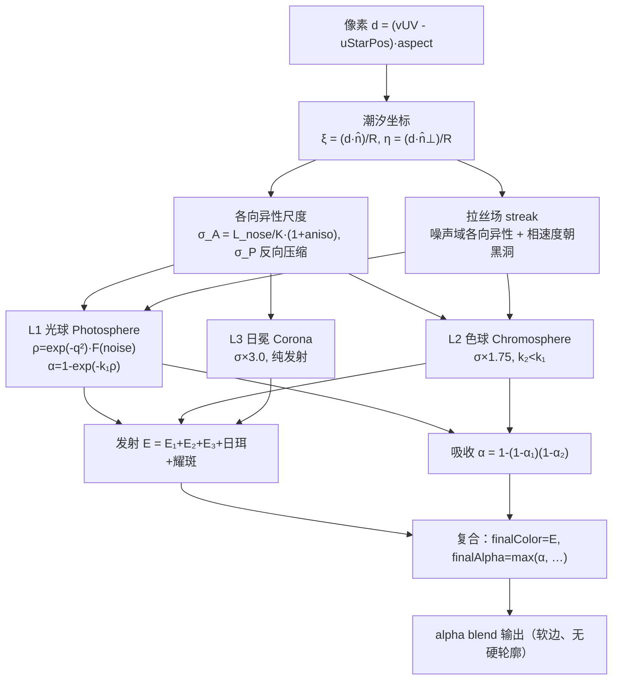

# 恒星材质与能量流重构 — 计划书

| 项目 | 内容 |
|------|------|
| 目标 | ① 彻底重构恒星材质（实心光球 → 分层体积气体）② 能量流可见并与本体一体化 ③ 流几何与黑洞真实盘绑定 |
| 代码库 | `d:\BlackHole\kerr`（Windows / C++17 / OpenGL 4.6 / ImGui / MinGW + CMake） |
| 当前版本 | v2.1（潮汐量纲与联动已实施并构建通过） |
| 本计划 | **v3.0** |
| 关联文档 | `恒星潮汐撕裂改进-计划书.md`（v2.1）。**本文档取代其 §7 Step B**，并修正其 S4 不变量的推导方式 |
| 前置事实 | Step A 实机验收后用户反馈：能量流不明显、被黑洞外围"挡住"、撕裂过程仍看不到、本体是实心光球、流与本体"不搭边" |

---

## 0. 为什么必须重做材质层（而不是继续调参）

v1.x 与 Step A 总共做了三件事：量纲有界化、双量分离、子系统联动。**材质层从未被触碰过。**
因此用户的三条不满共享同一个根：**恒星与能量流是两套互不相干的渲染语言。**

| 观感 | 根因 | 层级 |
|------|------|------|
| 流"不明显" | 宽度膨胀稀释 + 强度被平方削弱 + `*= p` 闸门把早期压成 0 | 量级 |
| 被"黑洞外围引力场挡住" | **不是遮挡**（流最后渲染、无 depth test）。真因是流的螺旋半径比真实吸积盘大 2.0~2.6 倍，末端悬在盘外并被 `bestDist > 1.5` 截断 | 几何失配 |
| 本体是实心光球 | `photoAlpha = 1.0` 硬编码；`finalAlpha = max(..., 1.0)` → 硬边不透明盘 | 材质架构 |
| 流与本体"不搭边" | ① 材质代际不一致（硬表面 vs 体积气体）② 二者均不参与引力透镜，都是屏幕空间贴片 | 架构 |

**结论：本轮做的是"架构与材质"，不是"参数"。** 继续调 `streamBright` 之类的旋钮不可能解决第 2、3、4 条。

---

## 1. 诉求

| # | 诉求 | 来源 |
|---|------|------|
| R1 | 恒星看起来"像活的"——有体积、有层次、持续演化，不再是一枚实心光球 | 用户原话 |
| R2 | 潮汐撕裂的**过程**必须看得见（数秒、连续、有始有终） | 用户原话 |
| R3 | 能量流必须明显——细、亮、有方向感，不被背景吞掉 | 用户原话 |
| R4 | 能量流与恒星本体必须是同一个物体的两部分（材质、色彩、动势连续） | 用户原话"根本不搭边" |
| R5 | 关闭 `tidalEnabled` 时，**撕裂形变**完全消失 | 既有约束的收紧版（见 D1） |

---

## 2. 现状证据（只读核实）

### 2.1 流的螺旋几何 vs 真实吸积盘（定量）

流 shader 自行重复推导了一遍黑洞尺度（`energy_stream_frag.glsl` 采样段 2），而真实尺度在 `blackhole.glsl` 中。两者公式巧合相同但**用途不同**：

| 量 | 流 shader 取值 | 黑洞 shader 真实值 | 比值 |
|---|---|---|---|
| 参考半径 | `rh = 0.133` UV | 0.133 UV（屏幕阴影半径） | 1.0 |
| 盘内径 | `1.8·rh = 0.24` | `(1.8/2.598)·0.133 = 0.092` | **2.6×** |
| 盘外径 | `min(6·rh, d·0.7) = 0.80` | `(8/2.598)·0.133 = 0.41` | **2.0×** |

流的螺旋圈（0.24→0.80 UV）整个悬在真实盘（0.092→0.41）**外围**，末端够不到盘；再叠 `if (bestDist > 1.5) discard`，靠近黑洞的那段被直接裁掉。
→ 这正是"被黑洞外围的引力场挡住"的真实机制：**流在一个不存在的大圆上自己消失了。**

### 2.2 可见性三重削弱

1. **宽度膨胀**（Step A 的 S4-b 引入，需自我修正）：尾端宽度被拉到 `0.085`；而起点 `noseWidth = R/(1+amp·0.55)`，`R=0.25, amp=0.6` → **0.188 UV ≈ 恒星半径的 75%**。流在恒星处根本不是细丝，而是一条与恒星等宽的带。
2. **强度平方**：贡献 ∝ `streamIntensity²`（`alpha` 与 `streamCol` 各乘一次），`p≈0.5` 时仅 ≈0.35。
3. **闸门过狠**：`streamIntensity *= tidalProgress` → 撕裂前半程流几乎为 0。

在**加色混合**（`GL_SRC_ALPHA, GL_ONE`）下，一条"宽而暗"的带叠加在已经很亮的橙色盘面上 = 信噪比不足 = 看不见。参考图里是"细而亮的丝"，那才是加色混合在亮背景上唯一能赢的形态。

### 2.3 实心光球

- `star_frag.glsl`：`if (nr < 1.0) { … photoAlpha = 1.0; }`
- 复合段：`finalAlpha = max(photoAlpha, …) = 1.0` → 硬边圆盘
- 无密度场、无吸收积分 → 边缘不可能透光弥散
- 唯一"气态"是 `nr > 1` 的 `exp(-distFromEdge·3.0)`，衰减常数 3.0 → 只剩贴边一圈
- 现有 4 层噪声（filaments/network/cells/sunspots）**只调制颜色**，不调制密度/不透明度

恒星渲染在**全屏 quad** 上（`star_vert.glsl` 输出 `aPos*0.5+0.5`），几何上没有任何尺寸限制——纯粹是材质没写。

### 2.4 架构级不对称

`frag_desktop_header.glsl` 的 `sampleBackground()` 在**透镜后的源 UV** 上采样桌面 + 粒子 FBO → 粒子盘参与引力透镜。
而恒星与能量流是在黑洞着色器**之后**绘制的屏幕空间叠加层 → 不参与透镜、不被阴影遮挡、不绕到黑洞背后。

→ "恒星+流"与"黑洞+盘"天然是两个图层。

---

## 3. 设计决策

| # | 决策 | 理由 |
|---|------|------|
| **D1** | 材质重构是**全局常开**的，由新增配置项驱动；`tidalEnabled` 只门控**撕裂形变/拉丝/消散** | 用户要的是"本体永远像活的"。若把材质也挂到 `tidalEnabled`，关闭开关就会退回实心球，与诉求 R1 冲突 |
| **D2** | **删除**坐标空间的逆向仿射形变，改为**密度场各向异性** | 逆向仿射产出的是"几何硬边椭圆"——正是用户厌恶的东西。体积气体应在**密度域**被拉长，不是把采样坐标压扁 |
| **D3** | 能量流仍保持**屏幕空间**（本轮不纳入引力透镜） | 用户已确认。用"几何对齐 + 材质统一"消除"不搭边"，把管线重排风险推迟 |
| **D4** | 流的盘内/外径由 **CPU 计算后以 uniform 传入** | 消除 shader 内重复推导（当前硬编码 `DEMO_SEC/DEMO_GROW_SEC`），并把流钉死在真实盘上 |
| **D5** | S4 交界不变量改为**从材质模型推导**，弃用魔数 0.55 | 原来两式互不相等（`R/(1+0.55a)` vs `R·(1-0.30a)`，a=0.6 时差 9%）。改为共用同一组解析式 |

---

## 4. 目标设计：分层体积气体恒星

### 4.1 总体结构



### 4.2 关键公式

**归一化常数** `K = sqrt(ln(1/ε))`，取 `ε = 0.05` → `K ≈ 1.7315`。
物理含义：密度降到 ε 处即为"可见边界"。

**可见半径不变量（D5，本体与流共用）**
```
L_nose(amp)  = R · (1 + amp)              本体沿潮汐轴的可见半长
W_nose(amp)  = R · max(1 - 0.30·amp, 0.35) 本体在鼻尖处可见半宽
σ_A = L_nose/K ,  σ_P = (R·(1-0.30·amp))/K / R 归一化后 = (1-0.30·amp)/K
```
`amp = 0` 时 `σ = 1/K = 0.5775` → 可见半径恰为 `1.000·R`，**基线尺寸不变**。

**各向异性 q²**
```
q² = (ξ/σ_A)² + (η/σ_P)²
```

**密度与吸收**
```
ρ    = exp(-q²) · F(noise)          // F ∈ [0.35, 1.65]
α_i  = 1 - exp(-k_i · ρ_i)
k₁ = 3.2（光球，较厚）   k₂ = 0.9（色球，薄）
```

**拉丝（R4 的核心：让"被抽走"看得见）**
```
q̃    = vec2(η, ξ)
streakUV = vec2(q̃.y · 1.2,  q̃.x · 3.0 - t · (0.35 + 3.5·strip))
streak   = fbm(streakUV, 3)
F(noise) = structure · mix(1.0, 0.55 + 0.90·streak, strip)
```
`strip = 0` 时退化为纯 `structure`（常态）；`strip → 1` 时表面出现**朝黑洞方向流动的条纹**，且相速度随 `strip` 增大 → 动势与流方向一致。

**本体的发射**
```
chord = sqrt(max(1 - min(q², 1), 0))         // 视向弦长 → 临边昏暗
coreCol = mix(uStarColor, vec3(1.0), 0.85)
E₁ = mix(uStarColor, coreCol, smoothstep(0.45, 1.0, ρ)) · (0.75 + 0.85·ρ) · (0.45 + 0.55·chord)
E₂ = uStarColor · ρ₂ · uCoronaBright · 1.10
E₃ = uStarColor · exp(-nr/1.10) · (0.30 + 0.70·streamers) · uCoronaBright   // 衰减由 3.0 → 1.10
```

**本体消散（原 v2 §3.4，并入本轮）**
```
α₁ *= 1 - uTidalBodyFade · smoothstep(0.35, 1.0, p)
E₁  *= 1 - 0.85 · uTidalBodyFade · smoothstep(0.35, 1.0, p)
```
质量不会凭空消失：同一份 `p` 已通过 `strip` 注入流的宽度/亮度。

**复合（替换现有硬编码 1.0）**
```
emitSum   = E₁ + E₂ + E₃ + glowCol + promCol + flareCol
absorb    = 1 - (1-α₁)(1-α₂)
finalAlpha = max(absorb, glowMask·0.5, prominence, flare·0.9) · uStarAlpha
finalColor = emitSum   // 已 ∝ ρ，边缘自然双向衰减
```

**性能闸门**（全屏 quad，必须早退）
```
if (q² > 6.0) { 只算 E₃ 日冕，跳过 4 层重噪声 }   // 重噪声仅在 q² ≤ 6.0 计算
if (nr > uCoronaSize · 3.0) discard;               // 由 2.5 → 3.0，容纳更厚日冕
```

### 4.3 能量流改造

**（a）几何绑定（D4）**
新增 uniform：`uDiskInnerUV`、`uDiskOuterUV`（aspect 校正 UV 半径）。
CPU 侧在 `ComputeBlackHoleCenter` 内已算出 `rhT`（= `HOLE_RADIUS·sz`）——将其作为出参暴露，并计算：
```
B_CRIT = 2.5980762
uDiskInnerUV = max(effDiskInner, 1.6)  / B_CRIT · rhT
uDiskOuterUV = max(effDiskOuter, rin+0.5)/ B_CRIT · rhT
```
shader 内删除自算的 `DEMO_SEC/DEMO_GROW_SEC` 与 `rh`，直接使用这两个 uniform。

**（b）可见性（R2）**
| 位置 | 现在 | 改为 |
|---|---|---|
| 强度闸门（`main.cpp`） | `*= tidalProgress` | `*= (0.30 + 0.70·p)` |
| 起点半宽（shader） | `R/(1+amp·0.55)` | `R·max(1-0.30·amp, 0.35)`（与本体同式，D5） |
| 尾端宽度（shader） | `mix(noseWidth, 0.015, s)`，Step A 后为 `0.085` | `mix(noseWidth, mix(0.010, 0.042, strip), sqrt(s))`（收窄更快） |
| 白芯占比 | `core·0.1` | `core·0.35`，且 `core` 阈值 `0.08 → 0.05` |

**（c）材质一体化（R4）**
流 shader 的 `starTint` 已在 CPU 侧取自 `activeStar->baseR/G/B`，与本体 `uStarColor` 同源——保持。
新增：把"近星段颜色 = 本体光球色 `E₁|边缘`"写为显式公式，使起点色温与本体**逐位可对齐**，而不是靠 `mix(colStarEnd, starTint, 0.85)` 的经验系数。

---

## 5. 验收标准

| # | 标准 | 判定方式 |
|---|------|---------|
| G1 | 常态恒星（未撕裂）呈现软边、可透视的层次感，无硬轮廓 | 视觉 |
| G2 | 本体表面持续演化（对流胞 + 拉丝流动），静止时也"活着" | 视觉 |
| G3 | 撕裂全程 ≥ 5 秒且连续可分辨；`p` 从 0→1 期间形变/流强度单调演化 | 视觉 + 日志 |
| G4 | 流自撕裂**起始**即可见（`p ≈ 0.1` 时已有一条细亮丝） | 视觉 |
| G5 | 流呈**细而亮**的丝状，宽度不随 `strip` 膨胀到与恒星等宽 | 视觉 + 数值 |
| G6 | 流的螺旋段落在黑洞**真实**吸积盘半径内（内径 0.092 / 外径 0.41 UV @ 默认档） | 日志断言 |
| G7 | 喇叭状可见边界与流起点**解析一致**：`noseLen = R(1+amp)`、`noseWidth = R·max(1-0.30amp,0.35)` | 单元测试 |
| G8 | 拉丝方向与"指向黑洞"方向一致；相速度随 `strip` 增大 | 视觉 |
| G9 | `uTidalBodyFade=0` 且 `tidalEnabled=false` 时形变/拉丝/消散全部为 0 | 视觉 + 单元测试 |
| G10 | 帧率不低于改动前（全屏 quad 早退生效） | 性能 |

---

## 6. 模块划分

| 模块 | 文件 | 职责 | 接口 |
|------|------|------|------|
| 恒星材质 | `shaders/star_frag.glsl` | L1/L2/L3 体积密度、拉丝、消散、复合 | 新增 `uTidalStrip`、`uTidalBodyFade` |
| 能量流 | `shaders/energy_stream_frag.glsl` | 几何绑定真实盘、细亮化、色彩对齐 | 新增 `uDiskInnerUV/uDiskOuterUV` |
| 黑洞几何 | `src/main.cpp` | 暴露 `rhT`，计算并注入盘半径 | `ComputeBlackHoleCenter(..., float* outShadowR)` |
| 配置 | `src/gui_config.h/.cpp` | 新增材质层配置项 | 见 §7 |
| 单元测试 | `src/tidal_model_test.cpp`（新增，独立可执行或并入现有测试） | 时间模型 + 形变映射纯函数镜像 | 见 §9 |

**依赖方向**：`gui_config` ← `main.cpp` → `shaders`（单向）。`tidal_model_test` 只依赖纯 C++ 头，不依赖 GL。
**无循环依赖。**

---

## 7. 接口契约（新增配置项）

| 键 | 类型 | 默认 | 范围 | 含义 |
|---|------|------|------|------|
| `starGasOpacity` | float | `3.2` | 0.5~8.0 | `k₁` 光球吸收系数（越大越实、越小越透） |
| `starChromoScale` | float | `1.75` | 1.0~3.0 | L2 色球相对 L1 的尺度倍数 |
| `starCoronaFalloff` | float | `1.10` | 0.5~4.0 | L3 日冕衰减常数（取代硬编码 3.0） |
| `starStreakAmount` | float | `0.90` | 0~2.0 | 拉丝对密度的调制强度 |
| `starStreakSpeed` | float | `3.50` | 0~8.0 | 拉丝相速度随 `strip` 的增益 |
| `tidalBodyFade` | float | `1.0` | 0~1 | **已存在**，本轮真正接入 L1 |

**兼容性**：旧配置文件的未知键被 `Config_Load` 直接跳过；新键缺失取默认值，无需迁移。

---

## 8. 技术栈

| 层 | 选型 | 理由 |
|---|------|------|
| 渲染 | 现有 OpenGL 4.6 单遍 fragment | 恒星已在全屏 quad 上；无需引入体积渲染/VRT，成本与风险最低 |
| 噪声 | 复用现有 `turbulentSeamless` / `fbm3D` / `fbm` | 3D 采样无 UV 缝；避免新增依赖 |
| 体积近似 | Beer–Lambert `α = 1-e^{-kρ}` + 视向弦长 `chord` | 单遍可算，物理上正确给出"边缘变薄透光"，是"气态感"的主因 |
| 耦合 | CPU 单点计算不变量 → uniform 广播 | 保证本体与流**不可能**各自漂移（沿用 S4 思路，修正其公式） |

**决策对比（体积感的实现路径）**

| 方案 | 优 | 劣 | 结论 |
|---|------|------|------|
| A. 单遍密度场 + Beer–Lambert（选定） | 成本低、无新依赖、与现有全屏 quad 契合 | 无法表现真正的自遮挡/多次散射 | **采用** |
| B. 多遍射线步进体积渲染 | 物理最真 | 成本高、需重排管线、与现有 alpha/加色混合冲突 | 否决 |
| C. 仅把 `photoAlpha` 从 1.0 改小 | 一行改动 | 只是"整体变透明"，无内部结构、无边缘变薄 | 否决（等于没重构） |
| D. 贴一张恒星贴图 | 立刻好看 | 静态、无体积、与流更不搭边 | 否决 |

---

## 9. 任务分解

| 任务 | 内容 | 前置 | 产出/DoD | 角色 |
|------|------|------|---------|------|
| T1 | 暴露 `rhT`；新增 `uDiskInnerUV/uDiskOuterUV` 注入；shader 删除自算 `rh` | — | 日志断言 G6 通过 | 后端/图形 |
| T2 | 新增 5 个材质配置项（默认值/存/取/ImGui 四处） | — | 配置往返一致 | 后端 |
| T3 | `star_frag.glsl`：L1 光球（密度场 + Beer–Lambert + 软边） | T2 | G1 达成 | 图形 |
| T4 | L2 色球 + L3 日冕（衰减 3.0→1.10）+ 性能早退 | T3 | G1 增强、G10 达成 | 图形 |
| T5 | 拉丝场 + 本体消散（接入 `tidalBodyFade`） | T3, T4 | G2 / G8 / G9 达成 | 图形 |
| T6 | 流可见性（闸门 `0.30+0.70p`；宽度收窄；白芯 0.35） | T2 | G4 / G5 达成 | 图形 |
| T7 | 流色彩与本体对齐（显式公式替换经验系数） | T5, T6 | G3 / G7 达成 | 图形 |
| T8 | 单元测试：时间模型 + 形变映射纯函数镜像（7 项断言） | T5 | 全绿 | 测试 |
| T9 | 全量构建 + 实机调参基线固化 | T1~T8 | 零 error；G1~G10 逐条勾选 | 全员 |

**依赖检查**：T1/T2 相互独立，可并行；T3 是 T4/T5 的前置；T6 与 T4/T5 独立（不同文件）。**无环。**

---

## 10. 风险与对策

| # | 风险 | 概率 | 影响 | 对策 |
|---|------|------|------|------|
| RK1 | 体积层使全屏 quad 开销上升 → 掉帧 | 中 | 高 | `q² > 6.0` 早退，重噪声只在内部计算；`uCoronaSize·3.0` 处 discard；先测帧率再调 `starCoronaSize` |
| RK2 | 常态恒星外观基线改变，用户需要重新调参 | 高 | 中 | 提供 `starGasOpacity/starChromoScale/starCoronaFalloff` 三个旋钮；先给一组"接近现状但软边"的保守默认值 |
| RK3 | 各向异性 σ 与流的 `noseLen/noseWidth` 再次漂移 | 中 | 高 | D5：不变量写成**唯一一个纯函数**，C++ 与 GLSL 各实现一份，T8 单测断言 `|diff| < 1e-6` |
| RK4 | `amp` 增大时 σ_P 压缩过度 → 本体细成一条线 | 中 | 中 | `W_nose` 下限 `0.35R`；`tidalStretch` GUI 上限由 2.0 收紧到 1.2 |
| RK5 | 流绑定真实盘后，盘半径随演示模式变化导致流"跳变" | 中 | 中 | 盘半径由 CPU 逐帧计算并**平滑**（对 `rhT` 做时间低通），或至少确认与 `blackhole.glsl` 同帧同值 |
| RK6 | 拉丝相速度过快 → 闪烁 | 中 | 低 | `starStreakSpeed` 上限 8.0；相速度对 `strip` 线性而非平方 |
| RK7 | 删除 `uBHInfluence` 后又发现其他引用点 | 低 | 低 | 实施前 grep 全库确认（v2.1 已完成，仅注释残留） |
| RK8 | 单遍近似下"内部结构"仍不够透 | 中 | 中 | 这是方案 A 的已知上限；若不足，后续再评估方案 B（已排除本轮） |

---

## 11. 实施路线图


| 里程碑 | 内容 | 验收 |
|--------|------|------|
| M1 | 流钉在真实盘上（T1） | G6 |
| M2 | 恒星成为分层体积气体（T2~T5） | G1 / G2 / G8 / G9 / G10 |
| M3 | 流细亮且与本体同源（T6~T7） | G3 / G4 / G5 / G7 |
| M4 | 全量回归 + 基线固化（T8~T9） | 全绿 |

---

## 12. 验证方案

### 12.1 单元测试（T8，纯 C++ 镜像）

把下列纯函数在 C++ 中镜像一份（与 GLSL 逐字对应），断言：

| # | 断言 | 期望 |
|---|------|------|
| 1 | `p` 在 `r = r_t` 时 33.3 s 到达 1.0 | `|t_full - 33.33| < 0.1` |
| 2 | `p` 在 `r ≤ r_t/3` 时 5.0 s 到达 1.0 | `|t_full - 5.0| < 0.05` |
| 3 | `p` 单调不减且 `p ≤ 1` | 500 步随机游走断言 |
| 4 | `amp = stretch·p^0.8` 有上界 `stretch` | `max(amp) ≤ 1.2` |
| 5 | `L_nose(amp)` 与 GLSL 同式 | `|diff| < 1e-6` |
| 6 | `W_nose(amp)` 与 GLSL 同式且 ≥ 0.35R | `|diff| < 1e-6` |
| 7 | `amp = 0` 时核验稳态 α 与期望值 | `α(0) > α(edge)`，且 `α(edge) < 0.05` |

### 12.2 运行时验证

| # | 验证 | 方式 |
|---|------|------|
| V1 | 流螺旋内/外径 | CPU 打印 `uDiskInnerUV/uDiskOuterUV` 与 `blackhole.glsl` 理论值比对 |
| V2 | 不变量 | 调参模式下打印 `noseLen/noseWidth`，与流 shader 内同式结果比对 |
| V3 | 过程时长 | 拖恒星入撕裂缝，秒表计时 `p: 0→1` 的墙钟时间 |
| V4 | 基线回退 | `tidalEnabled=false` + `tidalBodyFade=0` → 无任何形变/拉丝 |
| V5 | 帧率 | 改动前后各跑 30 s，比较平均帧时 |
| V6 | 编着色器 | 启动日志无 `Failed to compile`；无 GL 警告 |

---

## 13. 回滚

| 级别 | 手段 |
|------|------|
| 运行时 | `tidalEnabled=false`（撕裂全关）；`starGasOpacity=8.0` 近似回到实心 |
| 参数级 | `starStreakAmount=0` 关闭拉丝；`starCoronaScale=1.0` 关闭色球 |
| 代码级 | 材质重构集中在 `star_frag.glsl` 的 stage-0 段与 `main.cpp` 的 uniform 注入，均为 `if` 包裹的连续块，可整块回退 |

---

## 14. 变更记录

| 版本 | 日期 | 说明 |
|------|------|------|
| v3.0 | 2026-10-10 | 首版。定位"流不可见/被挡/实心球/不搭边"四象的共同根因（材质层从未重构 + 流几何与真实盘失配）；给出分层体积气体材质模型、拉丝一体化、流几何绑定（D1~D5）；取代 `恒星潮汐撕裂改进-计划书.md` 的 §7 Step B |