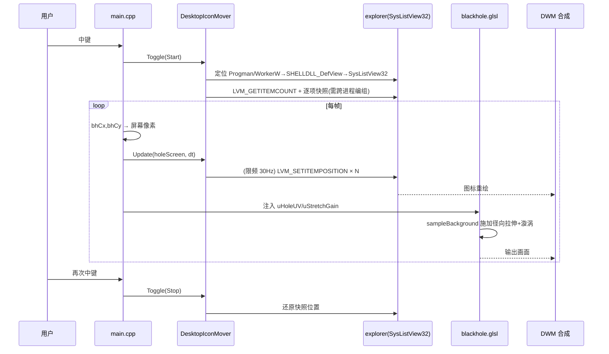

# 桌面图标漩涡吞噬（Icon Devour）实施计划书

| 项目 | 内容 |
|------|------|
| 文档版本 | v1.0 |
| 状态 | **待评审**（未批准前不进入编码） |
| 目标模块 | `BlackHole / kerr` |
| 关键文件 | `src/main.cpp`、`src/win32_gl.cpp`、`blackhole.glsl`、`shaders/frag_desktop_header.glsl`、`src/gui_config.h` |
| 触发方式 | 鼠标中键 |
| 效果诉求 | 图标被螺旋吸入 → 越靠近黑洞拉伸越强 → 拉成一根线 → 完全吞入 |

---

## 1. 目标与验收标准

### 1.1 功能目标

| 编号 | 目标 | 验收方式 |
|------|------|----------|
| G1 | 鼠标中键触发，桌面图标开始向黑洞中心螺旋吸入 | 中键后 1s 内可见图标位移 |
| G2 | 图标**真实位移**（explorer 图标位置被改变，而非仅视觉） | 暂停程序后图标仍在被移动的位置 |
| G3 | 越接近黑洞，图标被**径向拉伸越强**，最终呈线状 | 视界附近出现径向拖尾/面条化 |
| G4 | 图标到达视界后被完全遮蔽（"吞入"） | 中心区域无残留图标像素 |
| G5 | 持续时间无限，新出现的图标自动被纳入吞噬 | 运行中新建文件，若无自动排列则被吸入 |
| G6 | 再次中键可停止并还原 | 停止后图标回到快照位置 |

### 1.2 非目标（本批次不做）

- 不做图标**逐项淡出**（`SysListView32` 不支持单项 alpha，成本极高）。
- 不做跨显示器黑洞穿梭（保留既有单监视器模型）。
- 不修改 `explorer.exe` 进程、不注入。

---

## 2. 关键技术结论：为何必须是**混合方案**

> **这一节是本计划书最重要的部分，决定了整个架构。**

### 2.1 硬约束

`SysListView32`（桌面图标容器）由 `explorer.exe` 绘制，对外只暴露 `LVM_*` 消息。

| 能力 | 是否支持 | 说明 |
|------|----------|------|
| 改变单个图标位置 | ✅ `LVM_SETITEMPOSITION` / `LVM_SETITEMPOSITION32` | 坐标为整数像素，打包在 `lParam`，跨进程无需内存编组 |
| 读取单个图标位置 | ⚠️ `LVM_GETITEMPOSITION` | 需要 `POINT*`，跨进程须 `VirtualAllocEx`/`ReadProcessMemory` 编组 |
| **缩放 / 拉伸 / 旋转单个图标** | ❌ **不支持** | ListView 无此项能力，图标是刚性位图 |
| 改变单个图标透明度 | ❌ 不支持 | 无逐项 alpha |
| 改变单个图标 Z 序 | ❌ 不支持 | — |

**推论：用户要求的"无限拉伸成一根线"（spaghettification）无法通过移动真实图标实现。** 若只做路径 B，图标只会被"平移"到中心然后被覆盖，不会出现拉伸感。

### 2.2 机遇：现有架构天然适配拉伸

项目已具备两个关键能力：

1. **捕获**：WGC `CreateForMonitor` 捕获整屏（含真实图标）→ `iChannel0`（[capture_wgc.cpp](file:///d:/BlackHole/kerr/src/capture_wgc.cpp#L163-L174)）。
2. **重采样**：`blackhole.glsl` 通过 `sampleBackground()` → `texture(iChannel0, ...)`（[frag_desktop_header.glsl](file:///d:/BlackHole/kerr/shaders/frag_desktop_header.glsl#L119-L124)）对桌面纹理做任意 UV 扭曲。
3. **覆盖**：窗口 `TOPMOST + WS_EX_LAYERED`（[win32_gl.cpp](file:///d:/BlackHole/kerr/src/win32_gl.cpp#L356-L361)），画在图标之上，视界区域不透明黑，可自然"吞掉"图标。

**因此，拉伸只需在 `sampleBackground` 前对 UV 施加一个"视界附近径向拉伸 + 切向漩涡"的采样场即可。** 这是一个纯 shader 改动，且作用对象正是"包含图标的桌面画面"。

### 2.3 结论：混合方案

```
                    ┌───────────────────────────────┐
   中键触发 ──────► │  子系统 A：DesktopIconMover    │
                    │  （真实坐标）：把 explorer 图标 │
                    │  沿螺旋轨迹移向黑洞中心          │
                    └──────────────┬────────────────┘
                                   │ explorer 重绘
                                   ▼
                    WGC 捕获整屏（图标已在螺旋途中）
                                   │
                                   ▼
                    ┌───────────────────────────────┐
                    │  子系统 B：ShaderStretch       │
                    │  （视觉）：在 sampleBackground  │
                    │  前施加径向拉伸+切向漩涡场       │
                    │  → 图标像素被拉成线             │
                    └──────────────┬────────────────┘
                                   ▼
                        视界内图标被覆盖层吞没
```

- **子系统 A** 满足"真实移动"；
- **子系统 B** 满足"无限拉伸成线"；
- 两者**协调半径**：A 把图标移入视界半径内 → 被 B 的覆盖层遮蔽，避免"移动到中心却仍可见"的穿帮。

---

## 3. 系统架构

### 3.1 模块边界

| 模块 | 新增/修改 | 职责 |
|------|-----------|------|
| `src/desktop_icons.h/.cpp` | **新增** | 定位 ListView、快照/还原、螺旋驱动、动态发现、限频 |
| `blackhole.glsl`（根目录 + `kerr/`） | 修改 | 新增拉伸场函数，接入 `sampleBackground` |
| `src/gui_config.h/.cpp` | 修改 | 新增配置项 + ImGui 面板分组 |
| `src/main.cpp` | 修改 | 主循环挂接；中键事件接入 |

### 3.2 数据流

```
中键 → DesktopIcons_Toggle()
   ├─ 开始：Attach + Snapshot + 采集 ListView 原点
   └─ 停止：Restore + Detach
                    │
主循环（每帧）
   ├─ bhCx,bhCy = ComputeBlackHoleCenter(...)      [main.cpp L1344]
   ├─ holeScreen = (monX + bhCx*w, monY + (1-bhCy)*h)
   ├─ DesktopIcons_Update(holeScreen, dt)    → 限频发送 LVM_SETITEMPOSITION
   └─ shader uniform: uHoleUV, uStretchGain, uSwirlGain（供子系统 B）
```

### 3.3 主循环时序



---

## 4. 坐标系映射（已核实）

### 4.1 三层坐标

| 层 | 坐标系 | 来源 |
|----|--------|------|
| L1 shader UV | `[0,1]`，**Y 向上** | `bhCx/bhCy`，由 [main.cpp](file:///d:/BlackHole/kerr/src/main.cpp#L1344-L1352) 计算 |
| L2 监视器像素 | 物理像素，原点 = 监视器左上 | 窗口位于 `(monX,monY)`，尺寸 `w×h`（[win32_gl.cpp](file:///d:/BlackHole/kerr/src/win32_gl.cpp#L164-L166), [L269](file:///d:/BlackHole/kerr/src/win32_gl.cpp#L269)） |
| L3 ListView 客户区 | 整数像素，通常横跨整个虚拟桌面 | `SysListView32` 自身客户区原点（屏幕坐标） |

### 4.2 换算公式

```c
// L1 -> L2
float holeScreenX = monX + bhCx * (float)w;
float holeScreenY = monY + (1.0f - bhCy) * (float)h;   // UV Y 向上，需翻转

// L2 -> L3
int iconTargetX = (int)lroundf(holeScreenX - (float)lvOriginScreen.x);
int iconTargetY = (int)lroundf(holeScreenY - (float)lvOriginScreen.y);
```

**依据**：鼠标换算 `mouseY = 1 - cursorPos.y / height`（[main.cpp](file:///d:/BlackHole/kerr/src/main.cpp#L1760-L1764)）证明 UV 为 Y-up；`SetProcessDPIAware()`（[capture_wgc.cpp](file:///d:/BlackHole/kerr/src/capture_wgc.cpp#L200-L206)）保证全链路物理像素，无 DPI 缩放误差。

> ⚠️ **多显示器硬性要求**：ListView 横跨虚拟桌面，其客户区原点不等于主屏 `(0,0)`。**必须**用 `lvOriginScreen` 做偏移，否则副屏上整体错位。这是本方案最易踩的坑。

---

## 5. 核心算法

### 5.1 子系统 A：螺旋吸入（真实坐标）

每个图标快照 `S_i`，目标点 `C`（L3 坐标）：

```
d_i  = S_i - C
r_i0 = |d_i|,  θ_i0 = atan2(d_i.y, d_i.x)

t_i  = 该图标的启动偏移（按 r_i0 排序错峰，形成级联）
p_i  = max(0, (now - t_start - t_i))        // 单调递增，无限时长

r_i(p) = r_i0 * exp(-λ · p)                 // 指数内缩，渐近趋 0
θ_i(p) = θ_i0 + ω · p^1.5                   // 角速度随内缩递增 → 涡旋感

pos_i  = C + r_i(p) · (cos θ_i(p), sin θ_i(p))
```

**关键参数**：

| 参数 | 含义 | 建议初值 |
|------|------|----------|
| `λ` | 内缩速率 | 0.35 /s |
| `ω` | 旋转角速度 | 1.2 rad/s |
| `r_hide` | 进入视界半径（图标被覆盖层遮蔽） | 与 `holeRadius` 换算所得像素半径 |
| `throttleHz` | 发送频率 | 30 Hz |

**终止条件**：`r_i < r_hide` 后不再移动（停在中心，由覆盖层遮蔽）。**不删除、不隐藏**，避免与 explorer 状态不一致。

### 5.2 子系统 B：视界附近拉伸场（视觉）

在 `sampleBackground()` 采样前，对 UV 施加场（伪代码）：

```
d    = uv - holeUV
r    = length(d)
dir  = d / (r + eps)
θ    = atan2(d.y, d.x)

// 1) 径向拉伸：越近拉伸越强（1/r 发散）
r_src = r * (1.0 + stretchGain / (r + eps))

// 2) 切向漩涡：越近旋转越大
θ_src = θ + swirlGain / (r + eps)

uv_src = holeUV + r_src * vec2(cos(θ_src), sin(θ_src))
```

效果：屏幕上一个像素在某个半径上，采样自**更远处**的源纹理，导致源内容在径向被拉长 → 图标像素呈**面条状拖尾**；叠加切向旋转 → **螺旋卷入**。

> 具体函数形态、`stretchGain`/`swirlGain` 量纲与衰减曲线属**经验调参项**，在实施阶段用小范围可调 uniform 逐步标定（先固定默认值，再回归 GUI 可调）。

### 5.3 A / B 协调半径

| 半径区间 | A（真实图标） | B（shader） |
|----------|---------------|-------------|
| `r > r_stretch` | 沿螺旋移动 | 轻微扭曲 |
| `r_hide < r ≤ r_stretch` | 继续移动 | 强拉伸 + 漩涡（"成线"） |
| `r ≤ r_hide` | 停止移动（驻留中心） | 区域不透明，**遮蔽图标** |

`r_stretch > r_hide` 保证"先拉成线、再被吞"，避免图标未拉伸就消失。

---

## 6. 模块设计

### 6.1 `desktop_icons.h`（接口草案）

```c
#pragma once
#include <windows.h>

struct DesktopIconState;   // 不透明句柄

bool  DesktopIcons_Attach();                              // 定位 ListView
void  DesktopIcons_Detach();                              // 释放，不改图标
bool  DesktopIcons_IsAttached();

bool  DesktopIcons_Snapshot();                            // 记录原始位置
bool  DesktopIcons_Restore();                             // 还原原始位置

void  DesktopIcons_Update(float holeScreenX, float holeScreenY, float dt);
void  DesktopIcons_DiscoverNew();                         // 动态发现新图标
const char* DesktopIcons_LastError();
```

### 6.2 定位链

```
FindWindow(L"Progman", NULL)
  └─ FindWindowEx(progman, NULL, L"SHELLDLL_DefView", NULL)
       └─ FindWindowEx(defView, NULL, L"SysListView32", NULL)

// 若 Progman 下无 DefView（壁纸轮播 / Win11 常见）：
EnumWindows → 找 class=WorkerW，且其子窗口含 SHELLDLL_DefView → 再取其下 SysListView32
```

### 6.3 消息编组

| 操作 | 消息 | 跨进程要求 |
|------|------|-----------|
| 图标数量 | `LVM_GETITEMCOUNT` (0x1004) | 无需编组 |
| 读位置 | `LVM_GETITEMPOSITION` (0x1010) | **需** `VirtualAllocEx` + `WriteProcessMemory` + `ReadProcessMemory`，`POINT*` 指向 explorer 内存 |
| 写位置 | `LVM_SETITEMPOSITION` (0x100F) | **无需**编组（坐标打包在 `lParam`） |

> 快照需要读位置 → 必须实现一次跨进程内存编组。写位置不需要，这是本方案比"完全读写双向"简单得多的关键。

### 6.4 配置项（`gui_config.h` 新增）

```c
// ---- Desktop icon devour ----
bool  iconDevourEnabled   = false;   // 功能总开关
float iconDevourRate      = 0.35f;   // 内缩速率 λ
float iconDevourSpin      = 1.2f;    // 旋转角速度 ω
float iconDevourStretch   = 1.0f;    // shader 径向拉伸增益
float iconDevourSwirl     = 1.0f;    // shader 漩涡增益
float iconDevourStagger   = 0.15f;   // 错峰间隔（秒 / 图标）
int   iconDevourThrottleHz= 30;      // 坐标下发频率
bool  iconDevourRestore   = true;    // 停止时是否还原
```

---

## 7. 动态图标发现（"持续时间无限"必需）

因 `持续时间无限` + `有多少吞多少`，必须周期性重新枚举：

```
每 discoverInterval（建议 1.0s）：
  1. n = LVM_GETITEMCOUNT
  2. 若 n != 上次数量 或 抽样位置异常：
     - 对全部索引重新读取位置
     - 未知索引 → 加入吸收队列，r_i0 = 当前半径（从当前位置开始吸）
     - 消失索引 → 从队列移除（不报错）
  3. 与已知快照按 index 对齐；index 在会话内稳定，增删会导致后续索引平移
```

> **已知限制**：ListView 索引会因排序/增删而平移。计划采用"位置 + 文本哈希"作为弱身份标识以减少误配；若发现严重误配，则退化为"以位置为准"的近似（本功能为视觉特效，允许近似）。

---

## 8. 冲突与鲁棒性

### 8.1 `LVS_AUTOARRANGE`（最高优先级冲突）

若系统开启"自动排列图标"，explorer 会持续把图标弹回，与螺旋动画**持续打架**。

处理：
1. 启动前读 `GetWindowLongPtr(lv, GWL_STYLE) & LVS_AUTOARRANGE`，以及扩展样式 `LVS_EX_SNAPTOGRID`。
2. 若开启 → **临时移除** `LVS_AUTOARRANGE`，并在停止/退出时恢复。
3. 若移除失败（权限/被 explorer 重建）→ 在 GUI 中给出明确提示，功能降级为"仅视觉拉伸"。

### 8.2 explorer 刷新

文件增删、插拔设备、右键刷新会重置全部位置。

处理：接受为**已知限制**；`Restore` 前重新校验，避免把图标还原到已失效的坐标。

### 8.3 异常退出残留

若程序崩溃，图标会停在中心。

处理：
- `atexit` + `SetUnhandledExceptionFilter` + 窗口销毁路径统一调用 `Restore`。
- 提供独立"复位"入口（GUI 按钮）。

### 8.4 其他

| 场景 | 处理 |
|------|------|
| explorer 崩溃/重启 | 句柄失效 → `IsWindow` 校验，自动 `Detach` 并可选重新 `Attach` |
| 多显示器 | `lvOriginScreen` 偏移（见 §4.2） |
| UIPI 拦截 | 保持同完整性级别；若本程序以管理员运行，`SendMessage` 可能被丢弃 → 检测并告警 |
| 图标被用户拖动 | 快照与实时位置冲突 → 以"实时位置"为准继续吸（视觉特效可容忍） |

---

## 9. 性能

| 措施 | 说明 |
|------|------|
| 限频下发 | 图标坐标 30Hz 足够（远低于 60fps 渲染） |
| 变化阈值 | 目标位移 < 1px 的图标跳过发送 |
| 非阻塞发送 | `SendMessageTimeout(..., SMTO_ABORTIFHUNG, 20ms)`；超时则本帧跳过 |
| 批量节流 | 每帧最多处理 N 个图标（如 64），其余下帧继续 |
| 快速路径 | `r_i < r_hide` 的图标停止发送 |

参考量级：典型桌面 10–50 个图标 × 30Hz = 300–1500 次/秒消息；配合阈值与超时，可控制在 explorer 可承受范围。

---

## 10. 实施阶段

| 阶段 | 内容 | 交付 / 验证 |
|------|------|-------------|
| **P0** 基础 | `desktop_icons` 骨架：Attach / Snapshot / Restore / 跨进程读位置 | 单图标**静态**位移一次后能还原 |
| **P1** 吸入 | 中键触发；螺旋算法；无限时长；全图标级联 | 中键后图标螺旋滑向中心 |
| **P2** 动态 | 周期发现新图标 | 运行中新建文件被纳入（需关闭自动排列） |
| **P3** 拉伸 | `blackhole.glsl` 拉伸场 + uniform 注入 | 视界附近图标呈径向面条化 |
| **P4** 协调 | `r_stretch`/`r_hide` 阈值；覆盖遮蔽；还原 | "先成线、后被吞"顺序正确 |
| **P5** 鲁棒 | auto-arrange、explorer 重启、退出还原、限频调优 | 边界用例通过 |

> 每阶段独立验证全绿后再进入下一阶段（遵循增量实施原则）。

---

## 11. 风险清单

| 风险 | 级别 | 影响 | 缓解 |
|------|------|------|------|
| ListView 不能拉伸 → 仅移动无"成线"感 | **高** | 需求不符 | 混合方案：shader 拉伸（§2、§5.2） |
| `LVS_AUTOARRANGE` 持续复位 | **高** | 动画失效 | 临时移除 + 降级提示（§8.1） |
| 多显示器坐标错位 | 高 | 副屏错位 | `lvOriginScreen` 偏移（§4.2） |
| 跨进程读位置编组失败 | 中 | 快照失败 | 明确 `VirtualAllocEx` 流程；失败则禁功能 |
| explorer 刷新重置 | 中 | 效果中断 | 列为已知限制 |
| SendMessage 阻塞卡顿 | 中 | 掉帧 | 限频 + `SMTO_ABORTIFHUNG`（§9） |
| UIPI 拦截 | 中 | 消息被丢 | 同完整性级别 + 检测告警 |
| 崩溃残留图标 | 中 | 桌面被破坏 | 多路径统一 Restore（§8.3） |
| 索引平移误配 | 低 | 个别图标行为异常 | 位置+文本哈希弱标识（§7） |
| WGC 捕获反馈（移动后再被透镜） | 低 | 视觉叠加 | 可接受，必要时按序处理 |

---

## 12. 测试计划

### 12.1 功能

| 用例 | 期望 |
|------|------|
| 中键触发 | 图标开始螺旋吸入 |
| 再次中键 | 图标还原至快照位置 |
| 0 图标桌面 | 无异常、无崩溃 |
| 大量图标（>100） | 帧率无明显下降 |
| 视界附近 | 图标呈径向拉伸线条 |
| 完全吞入 | 中心无残留 |

### 12.2 边界

| 用例 | 期望 |
|------|------|
| 开启动画期间拖动图标 | 不崩溃（行为可近似） |
| 动画期间删除文件 | 优雅移除，不报错 |
| 动画期间 explorer 重启 | 自动 Detach/可重连 |
| 双显示器 | 副屏坐标正确 |
| 125%/150% DPI | 全链路物理像素，无缩放偏差 |
| 程序被强杀 | 图标可经 GUI 复位按钮恢复 |

> 单元测试建议：坐标换算（§4.2）、螺旋方程（§5.1）、错峰排序、`r_hide` 判定——这些为纯函数，可脱离 Windows 环境做表驱动测试。

---

## 13. 已确认决策（v1.1）

| # | 问题 | **决策** |
|---|------|----------|
| Q1 | 停止后是否还原？ | **还原原位**（`iconDevourRestore=true`）；退出/崩溃同样还原 |
| Q2 | 吞全部还是排除系统图标？ | **吞全部**（含回收站/此电脑等，统一按 ListView 索引处理） |
| Q3 | 拉伸场作用范围？ | **整个桌面**（壁纸/窗口/图标一并径向拉伸，纯 shader，§5.2） |
| Q4 | 是否加 GUI 实时滑块？ | **加**：ImGui 新增"图标吞噬"分组 |
| Q5 | 中键语义冲突？ | **二键共存**：`有中子星存在` → 中键坍缩；`无中子星` → 中键触发图标吞噬 |

### 13.1 中键共存逻辑（Q5 落地细则）

```
中键按下（上升沿）:
  if (存在 stage==NEUTRON_STAR 且 evo==EVO_IDLE 的恒星):
       执行中子星坍缩（既有逻辑，不变）
  else:
       DesktopIcons_Toggle()   // 开始/停止吞噬
```

> 即：**优先保持既有中子星语义**，仅在无中子星可坍缩时才交由吞噬接管，避免破坏现有演化流程。

---

## 附：变更记录

| 版本 | 日期 | 变更 |
|------|------|------|
| v1.0 | 2026-10-10 | 初稿：混合方案（真实移动 + shader 拉伸） |
| v1.1 | 2026-10-10 | 确认 Q1–Q5 决策；中键二键共存细则 |
