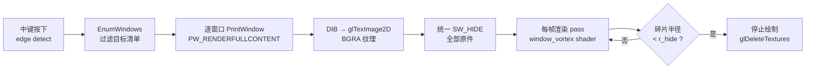

# 窗口吞噬 + 图标原地消失 — 计划书 v1.0

> 状态：**待用户批准**
> 前置依赖：图标吞噬（iconDevour）已上线，`desktop_icons.cpp` 螺旋方程可直接复用
> 权威源码树：`d:\BlackHole\kerr`

---

## 1. 执行摘要

实现两个功能：

| # | 功能 | 触发 | 效果 |
|---|---|---|---|
| F1 | **进程窗口吞噬** | 鼠标中键 | 屏幕上所有可见顶层窗口被螺旋扭曲、拉长、吸入黑洞，到达事件视界后直接消失（SW_HIDE，不杀进程，无恢复入口） |
| F2 | **图标原地消失** | 既有 iconDevour | 图标进入视界后从原位消失（移到屏幕外），不再滞留在黑洞经过的路径上 |

F2 是小改动（用户上轮已点名），随 F1 顺带实施。壁纸撕碎（用户提出的"纸张撕碎+黑色虚空"方案）技术上可行，放本计划书末尾预留章节，本轮不实施。

**核心决策**：窗口"消失"采用**抓帧-隐藏-重绘副本**路径——overlay 无法取消绘制 DWM 层的真实窗口，只能藏原件、画纹理副本。抓帧与隐藏压在同一触发时序内，无可见闪烁。

---

## 2. 需求（用户已拍板）

1. **触发**：中键，一次性吞噬当前屏幕上存在的全部窗口（错峰入场，同图标吞噬 stagger 节奏）
2. **不提供恢复**：被吞窗口 SW_HIDE 即可（任务栏按钮随之消失），不建恢复台账
3. **动画要求**（用户原话）："无限扭曲，变为螺旋状慢慢被吸入黑洞，吞掉之后不要再停留了啊，直接就消失了"
4. **壁纸**：留到最后单独讨论，本轮不做

---

## 3. 架构设计

### 3.1 数据流



### 3.2 渲染管线位置

GL 窗口为 `WS_EX_TOPMOST | WS_EX_TRANSPARENT`（[win32_gl.cpp#L180](file:///d:/BlackHole/kerr/src/win32_gl.cpp#L180)），永远盖在真实窗口之上。窗口碎片 pass 插入在**黑洞场景之后、ImGui 之前**：

- 碎片画在黑洞之上 → 碎片收缩进入黑洞阴影（默认档 ≈190px）后被黑洞本体剪影自然遮蔽
- `r_hide`（消失半径）设 40px——完全在黑洞阴影内部，**消失点被黑洞遮挡，无需额外 fade-out**，天然衔接"吞掉就消失"
- 被吞窗口 SW_HIDE 后，原位置露出桌面壁纸（GL 背景透明区域）——符合"最后只剩壁纸，壁纸再讨论"的路线

### 3.3 螺旋扭曲模型（与图标吞噬同源，观感统一）

复用 [desktop_icons.cpp#L430-L431](file:///d:/BlackHole/kerr/src/desktop_icons.cpp#L430-L431) 的螺旋方程，GLSL 化：

```glsl
// 顶点级：整体位置收缩（与图标同参数）
radius = r0 * exp(-uRate * p);
center = holeCenter + radius * vec2(cos(th0 + uSpin * pow(p, 1.5)),
                                    sin(th0 + uSpin * pow(p, 1.5)));
// 片元级：极坐标扭曲（"无限扭曲"的关键）
// 以黑洞中心为极点，采样坐标沿对数螺旋向后偏移，扭曲量随 p 增长
warp = pow(p, 1.5) * uWarpAmount;
uv = spiralWarp(uv, holeCenter, warp);   // 窗口内容被拉成涡旋条纹
```

- 顶点收缩 + 片元扭曲双层叠加：远看窗口整体螺旋吸入，近看窗口内容被撕成螺旋条纹
- 参数 `rate / spin / stagger` 与图标吞噬同名同默认值（0.35 / 1.2 / 0.15），GUI 独立分组但默认一致

### 3.4 抓帧时序（无闪烁的关键）

```
t0    : 中键 edge → 枚举（≈1ms）
t0+ε  : 逐窗口 PrintWindow（每窗 ≈5-15ms，此时所有真窗口仍可见）
t0+Σ  : 全部抓完 → 统一 SW_HIDE（一次批量）
t0+Σ+1: GL 渲染循环画出全部碎片纹理（覆盖原窗口位置）
```

真窗口从"可见"到"隐藏"之间隔着一整个抓帧周期（几十 ms），但期间窗口**仍然显示在原地**（尚未隐藏），视觉连续。碎片第一帧恰好出现在 SW_HIDE 生效的下一帧——无缝替换。

### 3.5 窗口过滤规则（排除清单）

| 规则 | 目的 |
|---|---|
| `IsWindowVisible && !IsIconic` | 基本可见性 |
| 排除自身 hwnd | 不吞自己 |
| 类名排除：`Progman / WorkerW / SHELLDLL_DefView / Shell_TrayWnd / Shell_SecondaryTrayWnd / tooltips_class32 / Windows.UI.Core.CoreWindow / Xaml_WindowedImmutableClass / MSCTFIME UI / 默认 IME` | 不吞 shell 骨架、任务栏、开始菜单、输入法 |
| `WS_EX_TOOLWINDOW` 排除 | 不吞无边框工具悬浮窗 |
| `DwmGetWindowAttribute(DWMWA_CLOAKED)` 非 0 排除 | UWP 挂起窗口抓帧是黑的 |
| 窗口尺寸 ≥ 80×80 | 排除杂项微窗 |

---

## 4. 模块划分

| 模块 | 文件 | 职责 |
|---|---|---|
| 窗口吞噬核心 | `src/window_devour.cpp/.h`（新建） | 枚举/过滤、抓帧、纹理上传、生命周期状态机 |
| 扭曲 shader | `shaders/window_vortex_vert.glsl` / `window_vortex_frag.glsl`（新建） | 顶点螺旋收缩 + 片元极坐标扭曲 |
| 触发与接线 | `src/main.cpp` | 中键 edge detect（仿 [main.cpp#L1864](file:///d:/BlackHole/kerr/src/main.cpp#L1864) 左键模式）、黑洞屏幕坐标传入、渲染 pass 插入 |
| GUI/配置 | `src/gui_config.cpp/.h` | 5 项配置四处齐备（默认/保存/读取/ImGui） |
| 图标滞留修复 | `src/desktop_icons.cpp` | F2，单点修改 |
| 资源同步 | `CMakeLists.txt` | 无需改（sync_assets 已 GLOB `shaders/*.glsl`，新 shader 自动同步） |

**黑洞屏幕坐标来源**：复用 `DesktopIcons_Update(holeScreenX, holeScreenY, dt)` 的现成变量（[main.cpp#L1436](file:///d:/BlackHole/kerr/src/main.cpp#L1436)），同一权威源。

---

## 5. 配置项（GUI 四处齐备模式）

| 键 | 默认 | 范围 | 说明 |
|---|---|---|---|
| `winDevourEnabled` | true | — | 功能总开关 |
| `winDevourRate` | 0.35 | 0.05~1.5 | 收缩速率（同图标 rate 语义） |
| `winDevourSpin` | 1.2 | 0~4.0 | 螺旋角速度 |
| `winDevourWarp` | 1.0 | 0~3.0 | 片元扭曲强度（窗口专用） |
| `winDevourStagger` | 0.15 | 0~1.0 | 窗口间错峰间隔 |

---

## 6. 任务分解

| ID | 任务 | 依赖 | 估算 | DoD（完成判据） |
|---|---|---|---|---|
| T1 | 枚举与过滤骨架：`window_devour.cpp` EnumWindows + 排除清单 + DPI awareness 核实 | — | 0.5 天 | 调试日志输出目标窗口清单（类名/标题/矩形），任务栏/桌面/开始菜单/本程序被正确排除 |
| T2 | 抓帧管线：PrintWindow → DIB → BGRA 纹理 → 统一 SW_HIDE | T1 | 1 天 | 中键触发后单窗口原位绘制静态纹理副本，无闪烁、无错位（多 DPI 下验证） |
| T3 | 螺旋扭曲动画：双 shader + 螺旋方程 + r_hide 消失 + 纹理清理 | T2 | 1 天 | 视觉验收：窗口扭曲成螺旋条纹、收缩、消失在黑洞阴影内；动画结束零纹理残留 |
| T4 | 触发接线 + GUI 配置四处 + 构建验证 | T3 | 0.5 天 | 中键触发、GUI 滑块实时生效、config 保存/读取往返一致、全量构建 + 既有单测全绿 |
| T5 | 边界加固：黑帧检测跳过、重复触发追加批次、多显示器、10+ 窗口压力测试 | T4 | 1 天 | 连续触发两批、4K 屏 15 窗口、双显示器场景无崩溃无泄漏（任务管理器观察显存/内存平稳） |
| T6 | F2 图标原地消失：`active=false` 前移到屏幕外 | — | 0.25 天 | 吞噬结束后黑洞移走，路径上无图标滞留；`restore` 功能仍能还原原位 |

顺序：T6 可与 T1 并行先行（独立、改动小、用户已点名）。总计 ≈ 4.25 人天。

---

## 7. 风险分析

| # | 风险 | 概率 | 影响 | 缓解 |
|---|---|---|---|---|
| R1 | 硬件加速窗口（Chrome/UWP）抓到黑帧或残帧 | 中 | 黑块被吸入，穿帮 | T5 黑帧检测（全 0 像素采样）→ 跳过动画直接隐藏该窗口 |
| R2 | 高 DPI（150%/200% 缩放）下抓帧尺寸与屏幕坐标错位 | 中 | 碎片位置偏移 | T1 核实进程 DPI awareness；若 per-monitor v2 未声明，改用 `DWMWA_EXTENDED_FRAME_BOUNDS`（物理像素，不含阴影） |
| R3 | 误吞关键 UI（输入法面板、文件管理器）导致用户懵 | 低 | 体验问题 | 排除清单硬编码 shell 类名 + 最小尺寸过滤；SW_HIDE 不杀进程，用户重启对应程序即恢复 |
| R4 | 大量 4K 窗口纹理爆显存（3840×2160×4B ≈ 33MB/窗） | 低 | 掉帧/分配失败 | 单窗纹理上限 2048（超出下采样 2×）；窗口数 > 12 时仅保留前 12 个按面积排序的窗口 |
| R5 | SW_HIDE 大批窗口时 explorer/DWM 瞬时负载尖峰 | 低 | 1~2 帧卡顿 | 可接受，不做分帧隐藏（会破坏"同一瞬间吞噬"的叙事） |

**已知限制（记录不修复）**：独占全屏模式游戏（真独占，非 borderless）无法被抓帧——这类窗口在 T5 黑帧检测中会被直接隐藏，无扭曲动画。

---

## 8. 壁纸撕碎 — 预留章节（本轮不实施）

用户方案（"整张壁纸本质是一张图片，可以像纸张一样被撕碎，最后被吸光后只剩下黑色虚空"）**技术上完全可行**，且比"擦除真壁纸"路线干净：

1. `SystemParametersInfo(SPI_GETDESKWALLPAPER)` / `IDesktopWallpaper` API 拿壁纸文件路径
2. 加载壁纸图（stb_image，项目已有纹理经验）→ 按"填充/适应/平铺"模式与屏幕对齐生成全屏纹理
3. overlay 全屏绘制壁纸纹理替代品（盖住真壁纸）
4. 撕碎动画：预三角化（Delaunay 网格）→ 碎片沿螺旋方程吸入（与 F1 同一套方程第三次复用）
5. 全部碎片吸走后 overlay 该区域保持纯黑 = "黑色虚空，什么都没有"

风险点：壁纸绘制与真壁纸的**像素级对齐**（缩放模式 × DPI × 多显示器），误差会被"撕碎边缘"部分掩盖。等窗口吞噬上线后单独开计划书。

---

## 9. 验收清单（用户实机）

1. 中键按下 → 屏幕上所有普通窗口（浏览器/资源管理器/记事本…）错峰开始扭曲，被撕成螺旋条纹旋转吸入黑洞
2. 碎片到达黑洞中心即消失，黑洞移走后原窗口位置只剩桌面壁纸，无任何窗口残影
3. 任务栏、开始菜单、桌面图标本体（iconDevour 另管）不被吞
4. 吞噬进行中再次按中键 → 追加吞噬新出现的窗口
5. GUI"窗口吞噬"组：速率/螺旋/扭曲/错峰滑块实时生效，保存后重启保持
6. iconDevour 吞过的路径上无图标滞留（F2）
